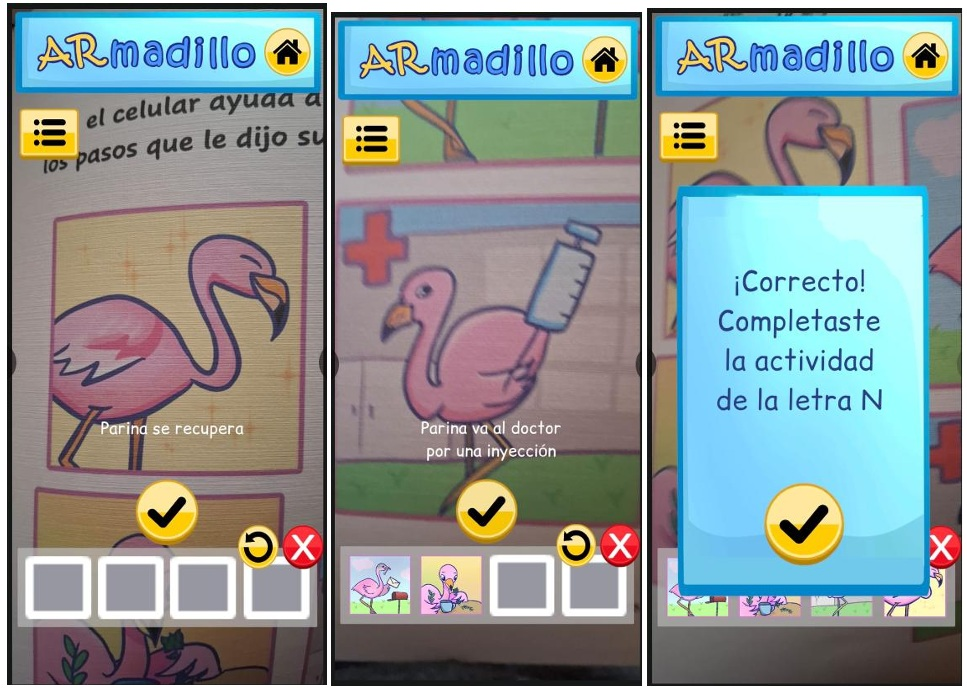
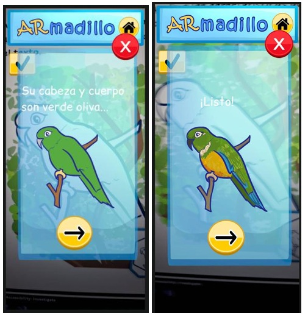
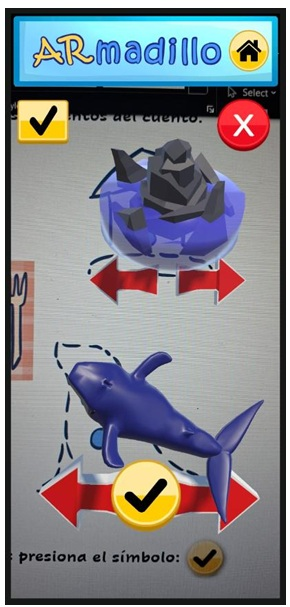
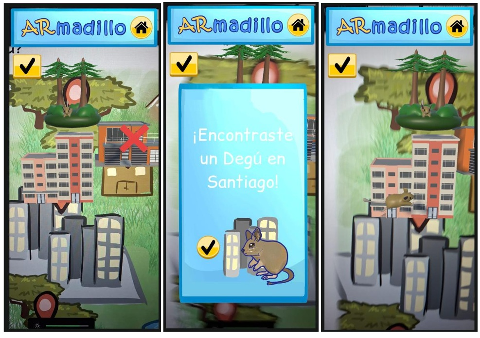
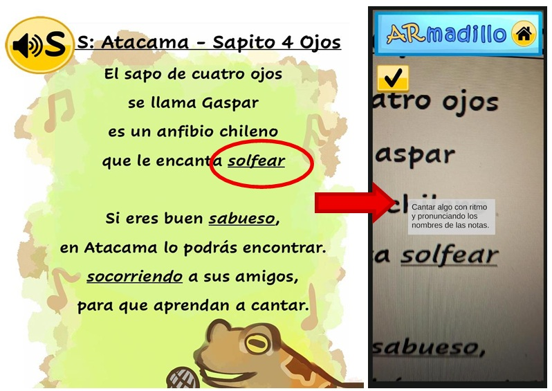

# ARmadillo Libro

> Prototipo de libro físico con realidad aumentada.

## Resumen

* Aplicación de android que ayuda a la comprensión lectora en niños utilizando realidad aumentada en conjunto con un libro físico.
* Proyecto de memoria de Universidad Técnica Federico Santa María

## Features

Actividades de comprensión lectora:

Ordenamiento de sucesos



Dibujo



Recrear escena



Búsqueda en ilustración



Definiciones



## Tecnologías

* **Language:** C#
* **Game Engine:** Unity.
* **Packages:** AR Foundation.

## Probar la aplicación

Dentro del repositorio:

```bash
1. Buscar carpeta builds
2. Descargar test2.apk en celular android
3. Instalar la aplicación del test2.apk
4. Correr aplicación
```


## Correr el proyecto

* Clonar repositorio:

```bash
git clone https://github.com/dnyss/ARmadillo-Book/tree/main
```

* Abrir carpeta ARBook en Unity

* Correr proyecto en Unity

## Estructura del proyecto

```text
ARBook/
├── Assets/
│   ├── 3D Models/
│   ├── Markers/
│   ├── MobileARTemplateAssets/
│   ├── Prefab/
│   ├── Resources/
│   ├── Samples/
│   ├── Scenes/
│   ├── Scripts/
│   ├── Settings/
│   └── ...
├── Builds/
├── .gitignore
├── README.md
```

Directorios importantes:

| Directorio | Descripción |
| ---------- | ---------- |
| Markers | imágenes que se detectan en la aplicación y activan modelos en realidad aumentada. |
| Prefabs | Contiene prefabs que se activan con los markers para cada actividad y prefabs. |
| Scenes | Escenas del proyecto. |
| Scripts | Archivos de código. |
